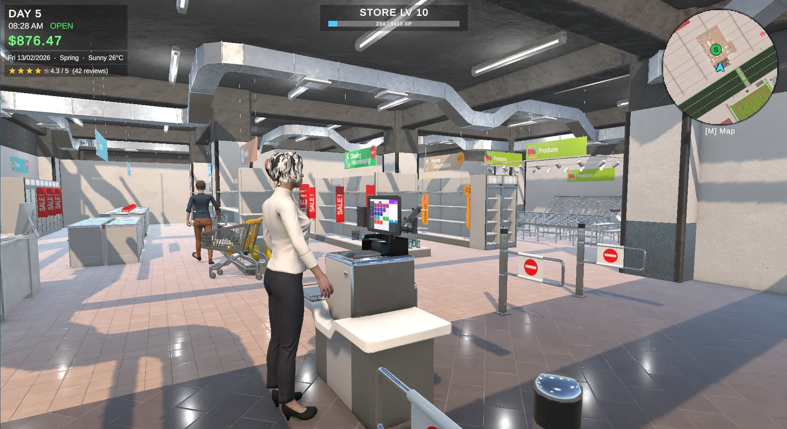
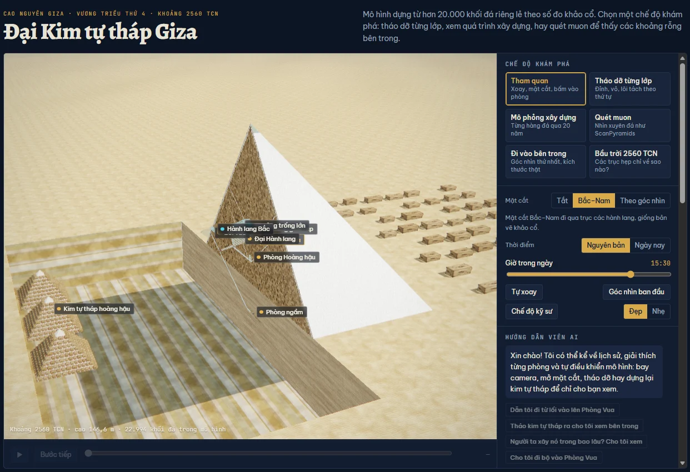

  
  
  

I work across two layers most people keep separate. By day I help run the network that carries national broadcast data at **Vietnam Television (VTV)**. In my own projects I build **AI agents, data pipelines, 3D web apps and games**, and I measure every one of them.

- Final-year **BSc Computer Science, University of Greenwich**, GPA 3.62 / 4.0
- **Network administration** at VTV Technology and Transmission Center, since 06/2025
- **Microsoft Ambassador** · **CCNA** · Top 20 nationwide, **FPT Edu Hackathon**
- Open to **AI engineering and data** roles in Hanoi or remote

## Featured work

<table>
  <tr>
    <td width="50%" valign="top">
      
      <h3><a href="https://github.com/vuthevinh2125/VietUrban_Simulation_Team">VietUrban Supermarket Simulator</a></h3>
      First-person management game set on a Vietnamese street: run the store, deliver by motorbike, deal with weather, traffic and nine kinds of AI agents.
        
      <b>+61%</b> average FPS · <b>×18</b> 1% lows in storms · <b>38/38</b> automated tests · <b>23</b> bugs fixed at root cause
        
      <code>Unity 6</code> <code>C#</code> <code>URP</code> <code>NavMesh</code> <code>Utility AI</code> <code>Unity Test Framework</code>
    </td>
    <td width="50%" valign="top">
      
      <h3><a href="https://vuthevinh2125.github.io/giza-pyramid-3d/">Giza: The Great Pyramid in 3D</a></h3>
      Khufu's pyramid from 22,994 stones placed to survey data. Take it apart, walk the passages, find the Big Void with simulated muons, and ask a Claude guide that drives the scene.
        
      <b>7</b> scene tools for the AI agent · <b>20</b>-case agent eval · <b>13,200</b> muon rays per scan
        
      <code>three.js</code> <code>WebGL / GLSL</code> <code>Claude API</code> <code>Tool use</code> <code>Cloudflare Workers</code>
       
      <a href="https://vuthevinh2125.github.io/giza-pyramid-3d/">Live demo</a> · <a href="https://github.com/vuthevinh2125/giza-pyramid-3d">Source</a>
    </td>
  </tr>
  <tr>
    <td width="50%" valign="top">
      <h3>Automated Daily News Aggregator</h3>
      FPT Edu Hackathon, <b>Top 20 nationwide</b>. Collects 1,000+ articles a day from VnExpress, Tuổi Trẻ and Thanh Niên, groups duplicates with PhoBERT embeddings and summarizes with an LLM.
        
      <b>−85%</b> duplicates · <b>92%</b> topic accuracy · <b>−80%</b> manual curation
        
      <code>Python</code> <code>PhoBERT</code> <code>PostgreSQL + pgvector</code> <code>OpenAI API</code> <code>Selenium</code>
    </td>
    <td width="50%" valign="top">
      <h3><a href="https://github.com/vuthevinh2125/portfolio">This portfolio</a></h3>
      Bilingual (VIE / ENG) single-page site with an auto demo where four agent cursors build the page frame by frame. Every change is logged in its <a href="https://github.com/vuthevinh2125/portfolio/blob/main/CHANGELOG.md">changelog</a>.
        
      <code>HTML</code> <code>CSS</code> <code>JavaScript</code> <code>Canvas</code> <code>GitHub Pages</code>
       
      <a href="https://vuthevinh2125.github.io/portfolio/">Open the site</a>
    </td>
  </tr>
</table>

## Stack

**AI & data** 
 &nbsp; Claude API · tool-use agents · agent evals · PhoBERT · pgvector · Pandas · scikit-learn · Power BI

**3D, graphics & games** 
 &nbsp; WebGL / GLSL · stencil-buffer rendering · PBR · URP · game AI

**Infrastructure & tooling** 
 &nbsp; CCNA routing & switching · Cloudflare Workers · GitHub Pages · automated testing

**Also** 
 &nbsp; Java · PHP · SQL Server

---

Song ngữ? Portfolio có cả tiếng Việt: <a href="https://vuthevinh2125.github.io/portfolio/#vi">vuthevinh2125.github.io/portfolio/#vi</a>
